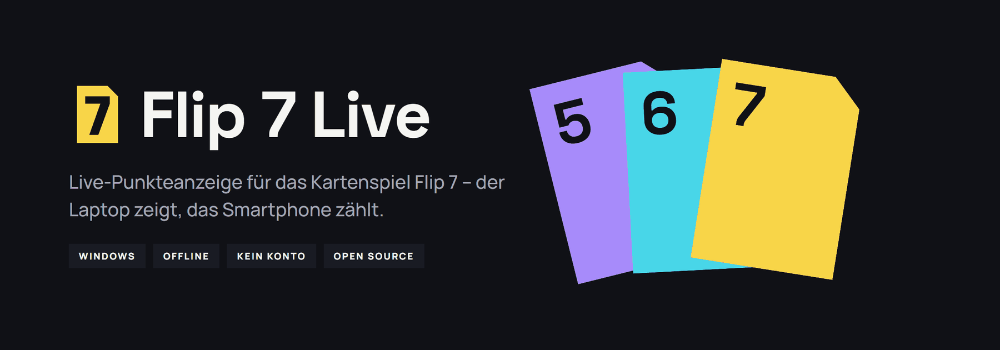
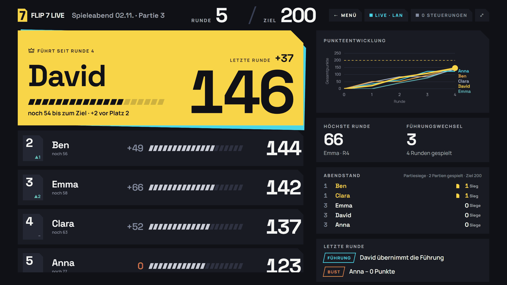
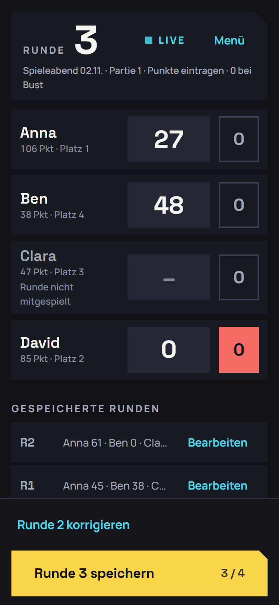
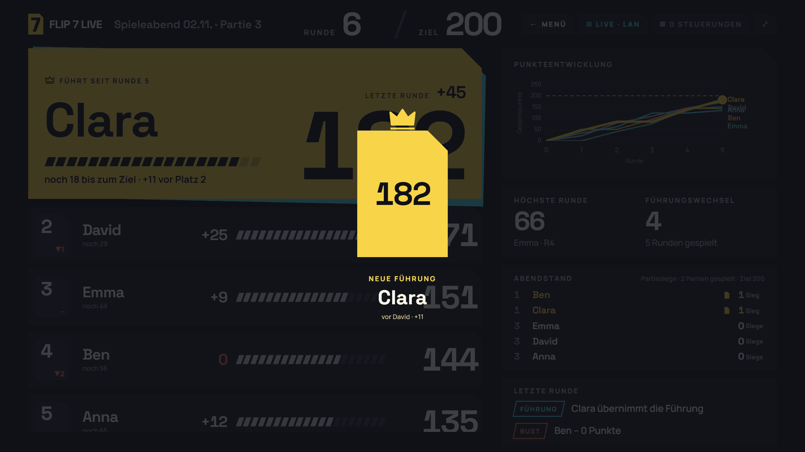
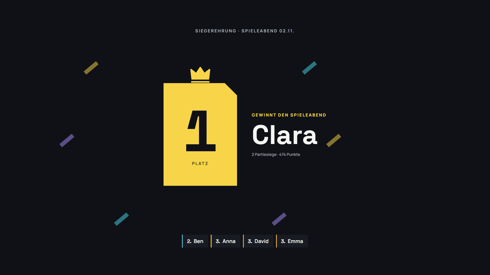
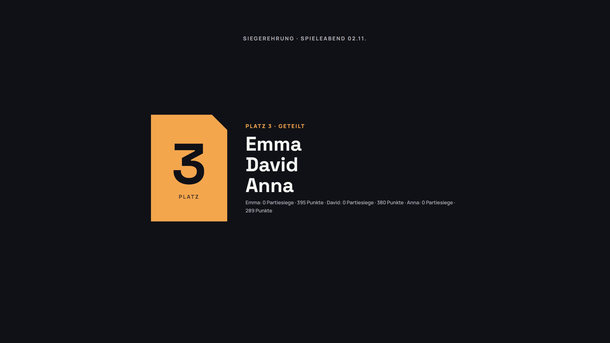
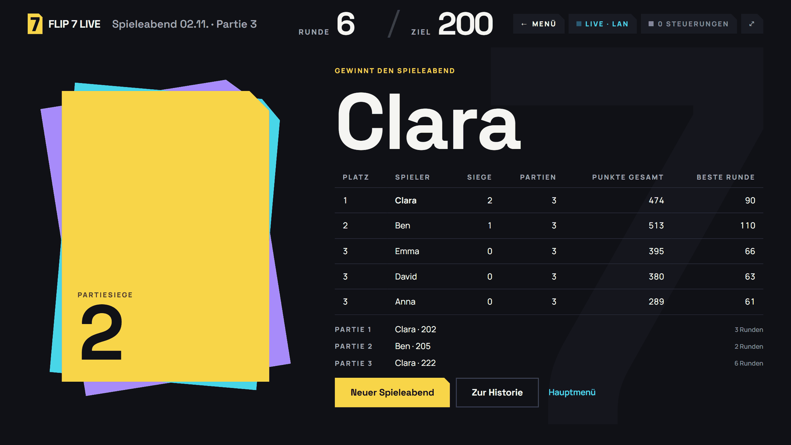
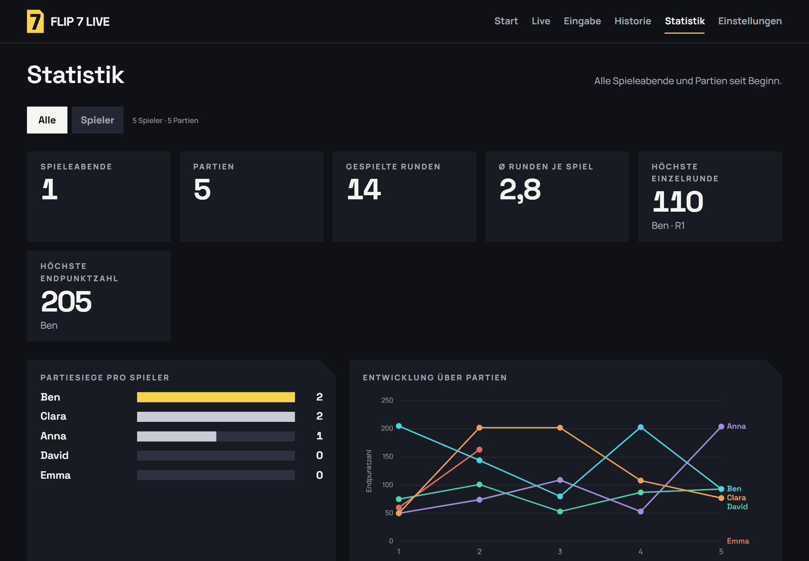
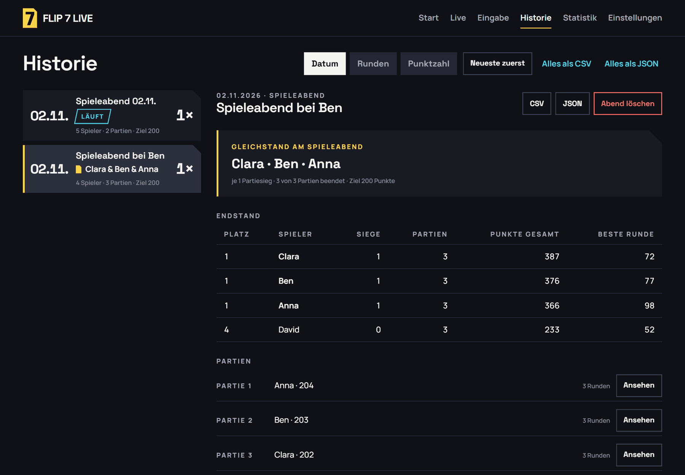
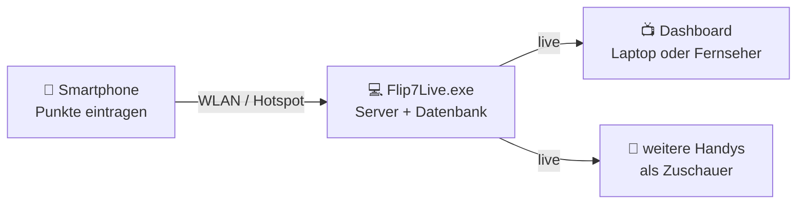

<p align="center">
  
</p>

<p align="center">
  <a href="../../releases/latest"></a>
  
  
  <a href="LICENSE"></a>
</p>

**Flip 7 Live** macht aus deinem Laptop eine Anzeigetafel für Spieleabende mit **Flip 7**. Rangliste, Punkteverlauf und
Gewinner erscheinen groß auf dem Bildschirm (oder dem Fernseher), die Punkte tippt ihr nach jeder Runde einfach am
Smartphone ein. Kein Internet, keine Cloud, kein Konto, keine App-Installation auf dem Handy.

<p align="center">
  
</p>

## Funktionen

| | |
|---|---|
| 📺 **Live-Dashboard** | Führung, Rangliste mit Fortschrittsbalken, Punkteverlauf, Abendstand – aktualisiert sich sofort nach jeder Eingabe. Vollbild- und TV-Modus. |
| 📱 **Eingabe am Smartphone** | QR-Code scannen, fertig. Punkte aller Spieler eintragen, „0“-Knopf für Bust, Runden nachträglich korrigieren. Mehrere Handys gleichzeitig möglich. |
| 🃏 **Spieleabende** | Mehrere Partien hintereinander mit festem Punkteziel. Am Ende zählt, wer die meisten Partien gewonnen hat. |
| ✨ **Animationen** | Neue Führung, beste Runde, kurz vor dem Ziel, traurige Null – und am Abendende eine **Siegerehrung** vom letzten Platz bis zum Sieger. |
| ⏸️ **Runde aussetzen** | Wer eine Runde nicht mitspielt, bekommt einfach keine Punkte – das zählt auch nicht in die Statistik. |
| 📊 **Statistik & Historie** | Siege, Siegquote, Durchschnitt, beste Runde – für alle oder einzelne Spieler. Jeder Abend und jede Partie bleibt nachlesbar, Export als CSV/JSON. |
| 📶 **Netzwerk-Assistent** | Erkennt WLAN, LAN und Hotspot selbst, hilft bei Firewall und „öffentlichem“ Netzwerk und erzeugt den passenden QR-Code. |
| 💾 **Sicher gespeichert** | Alles liegt lokal in einer SQLite-Datenbank mit automatischen Sicherungen. Ein Update der EXE löscht keine Spielstände. |

## So sieht es aus

<table>
  <tr>
    <td width="30%" valign="top"><br><sub><b>Eingabe am Smartphone</b> – leeres Feld = Runde nicht mitgespielt</sub></td>
    <td width="70%" valign="top"><br><sub><b>Einblendungen</b> nach jeder Runde – hier: neue Führung</sub><br><br>
      <br><sub><b>Siegerehrung</b> – vom letzten Platz bis zum Sieger, jede Stufe größer als die vorige</sub></td>
  </tr>
</table>

<table>
  <tr>
    <td width="50%"><br><sub>Platz 3 in der Siegerehrung</sub></td>
    <td width="50%"><br><sub>Danach: der Abend-Endstand</sub></td>
  </tr>
  <tr>
    <td width="50%"><br><sub>Statistik über alle Spieleabende</sub></td>
    <td width="50%"><br><sub>Historie mit jedem Abend und jeder Partie</sub></td>
  </tr>
</table>

## So funktioniert's



Der Laptop ist die einzige „Wahrheit“: Jede Eingabe wird dort gespeichert, neu berechnet und sofort an alle verbundenen
Geräte verteilt. Fällt das WLAN kurz aus, verbinden sich alle Geräte von selbst wieder – der Spielstand bleibt erhalten.

## Download & Start

1. **[`Flip7Live.exe` herunterladen](../../releases/latest)** – eine einzige Datei, keine Installation (läuft auch vom USB-Stick).
2. Starten. Beim ersten Mal führt ein **Einrichtungsassistent** durch Netzwerk, Firewall und Smartphone-Verbindung.
3. Den **QR-Code** auf dem Laptop mit dem Smartphone scannen – die Eingabe öffnet sich direkt im Browser.
4. **Spieleabend starten**, Spieler auswählen, Punktzahl pro Partie festlegen – los geht's.

Flip 7 Live läuft danach im Hintergrund weiter: Das gelbe **„7“** im Infobereich (unten rechts) öffnet das Dashboard,
zeigt die Verbindung oder beendet das Programm.

**Systemvoraussetzungen:** Windows 10 oder 11 (64 Bit) und ein Smartphone mit Browser im selben WLAN – oder ein Hotspot
(vom Laptop oder vom Handy). Für den Spielbetrieb sind keine Administratorrechte nötig.

> [!NOTE]
> Die EXE ist nicht digital signiert. Windows SmartScreen zeigt deshalb beim ersten Start „Der Computer wurde durch
> Windows geschützt“ – über **Weitere Informationen → Trotzdem ausführen** startet sie. Ist in Windows 11 die
> **Smart App Control** aktiv, blockiert Windows unsignierte Programme grundsätzlich; dann bleibt nur der Start aus dem
> Quellcode (siehe unten). Die Prüfsumme jeder Version steht in `SHA256SUMS.txt` beim Release.

### Tastatur im Dashboard

**F** Vollbild · **Q** QR-Code zum Verbinden · **Esc** schließen · TV-Modus unter Einstellungen › Anzeige

### Rollen

| Gerät | Darf |
|---|---|
| Browser am Laptop | alles, inkl. Einstellungen (Administrator, nur direkt am Laptop) |
| Smartphone mit **Steuerungs-QR-Code** | Spieleabende anlegen, Punkte eintragen und korrigieren |
| Weitere Geräte mit **Zuschauer-QR-Code** | nur zuschauen |

## Wenn's hakt

| Problem | Lösung |
|---|---|
| Das Handy öffnet die Seite nicht | Beide Geräte im selben WLAN? Kein Gast-WLAN? Ist das Netzwerk in Windows „Öffentlich“, in Flip 7 Live unter **Einstellungen › Netzwerk** auf „Privat“ stellen und freigeben (eine Windows-Abfrage). |
| Kein WLAN vorhanden | Hotspot am Smartphone einschalten und den Laptop damit verbinden – Internet ist nicht nötig. Oder den Windows-Hotspot nutzen. |
| Punkte falsch eingetragen | Am Handy bei „Gespeicherte Runden“ auf **Bearbeiten** – alles wird neu berechnet. |
| Partie versehentlich beendet | **Partie fortsetzen** am Handy. |
| Anzeige „Getrennt“ | Kurz warten – die Verbindung baut sich von selbst wieder auf. |
| Probleme nach einem Update | **Einstellungen › Daten & Backup** → Sicherung wiederherstellen. |

## Datenschutz

Flip 7 Live sendet **nichts ins Internet** und lädt nichts nach – alle Schriften und Bibliotheken sind eingebaut. Spieler,
Runden und Einstellungen liegen ausschließlich auf deinem Laptop unter `%LOCALAPPDATA%\Flip7Live`. Im WLAN ist die App
durch zufällige Zugangscodes im QR-Code geschützt; Einstellungen lassen sich nur direkt am Laptop ändern.

## Entwicklung

Voraussetzung: Windows und Python 3.12 oder neuer (entwickelt mit 3.15).

```powershell
git clone https://github.com/thisislennard/Flip7Stats.git
cd Flip7Stats
.\scripts\run_development.ps1                 # richtet .venv ein und startet aus dem Quellcode
.\scripts\run_development.ps1 -DataDir .\dev  # eigener Datenordner zum Ausprobieren
.venv\Scripts\python -m pytest                # Tests
.\scripts\build_windows.ps1                   # Tests + PyInstaller → dist\Flip7Live.exe
```

Aufbau: Flask + Flask-SocketIO (WebSocket), SQLAlchemy/SQLite mit Alembic-Migrationen, Pydantic, Oberfläche in reinem
JavaScript ohne Build-Schritt. Mehr dazu:

- [Architektur](docs/ARCHITECTURE.md) – Module, Datenfluss, Live-Kommunikation, Netzwerk, Sicherheit
- [API](docs/API.md) – REST-Endpunkte, Fehlercodes, Socket.IO-Ereignisse
- [Datenbank](docs/DATABASE.md) – Tabellen, Migrationen, Sicherungen

## Lizenz

[MIT](LICENSE). Mitgelieferte Komponenten: Socket.IO-Client und Chart.js (MIT, Lizenztexte unter
`app/static/js/vendor/`), Schriften Space Grotesk und Manrope (SIL Open Font License 1.1, `app/static/fonts/OFL.txt`).

Flip 7 Live ist ein privates Fanprojekt und steht in keiner Verbindung zum Verlag des Kartenspiels **Flip 7**. Das Spiel
selbst brauchst du natürlich trotzdem. 🃏
